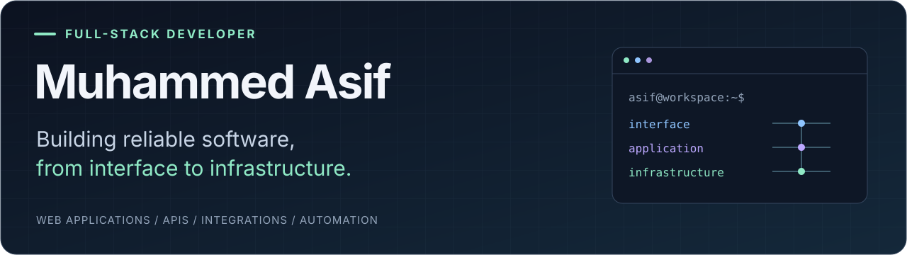

<picture>
  <source media="(max-width: 600px)" srcset="assets/profile-hero-mobile.svg" />
  
</picture>

## About

I'm **Asif**, a full-stack developer from **Kannur, Kerala, India**. I build web applications and backend systems, working across frontend interfaces, APIs, databases, payment integrations, and automated workflows.

My work involves translating product requirements into functional software, connecting services, implementing business logic, and improving performance and reliability. Most of my professional work lives in private company repositories.

## What I build

- **Web applications** - Responsive interfaces, administrative dashboards, CRM systems, and full-stack applications with React and Next.js.
- **Backend systems** - REST APIs, authentication, authorization, business logic, and database architecture, including Laravel applications with Inertia.js and React.
- **Payment integrations** - Gateway integrations, webhook processing, transaction verification, and reconciliation.
- **Background processing** - Scheduled jobs, workers, notifications, automated workflows, and data synchronization.
- **System integrations** - Third-party APIs and communication between applications and external services.

## Toolkit

React.js · Next.js · TypeScript · JavaScript · Tailwind CSS · Material UI · Framer Motion 
Data and validation: TanStack Query · React Hook Form · Zod

Node.js · Express.js · Laravel · PHP · Inertia.js 
REST APIs · Authentication and authorization · Business logic

MongoDB · MySQL

Stripe · Razorpay · Telr · Webhooks · Third-party APIs 
Payment verification and reconciliation

Git · GitHub · pnpm · npm · Postman · Linux · VS Code

## Featured projects

*A public case study will be added here when suitable work is ready to share.*

<!-- Future project entry: verified project name, one-sentence description,
main technologies, and actual repository URL. Include a live demo only when
it exists. Keep private company information and implementation details out. -->

## GitHub activity

[View contribution history on GitHub](https://github.com/Muhd-Asif-1?tab=overview#contributions). Private company work may not be reflected in public activity.

## Engineering interests

Areas I work with and want to explore further: backend architecture, system design, scalable applications, payment reliability, API design, database optimization, and performance and reliability engineering.

## Let's connect

  &nbsp;
  &nbsp;
  

