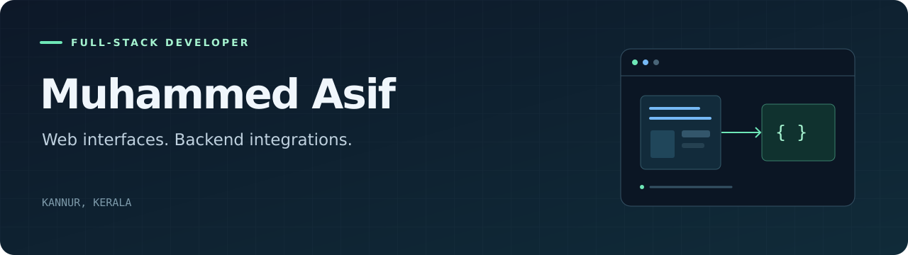

  

  <a href="https://github.com/Muhd-Asif-1?tab=repositories">Explore my repositories</a>
  &nbsp;·&nbsp;
  <a href="mailto:muhdasif.in@gmail.com">Get in touch</a>

## Hi, I'm Asif 👋

I'm a full-stack developer based in **Kannur, Kerala, India**. I build web interfaces and backend integrations, from shopping experiences to services that connect physical devices with web applications.

## Selected projects

| Project | What it does | Built with |
| :--- | :--- | :--- |
| **[E-Commerce Project](https://github.com/Muhd-Asif-1/E-Commerce-Project)** | A storefront with product browsing, cart, checkout, and sign-in screens. | Next.js · React · TypeScript · Tailwind CSS |
| **[Attendance Sync](https://github.com/Muhd-Asif-1/attendance-logs-api)** | Connects to a ZKTeco attendance device and syncs attendance logs and users to a backend API on a schedule. | Node.js · Express · node-cron · ZKLib |

## Technologies in my projects

**Frontend** &nbsp; `React` `Next.js` `TypeScript` `Tailwind CSS`

**Backend & integrations** &nbsp; `Node.js` `Express` `JavaScript` `REST APIs`

**Tools** &nbsp; `Git` `GitHub` `npm` `pnpm`

---

Have a project or an integration to discuss? **[Let's talk.](mailto:muhdasif.in@gmail.com)**
