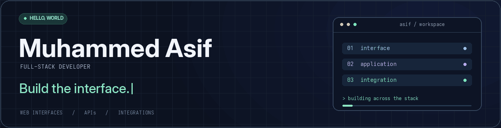
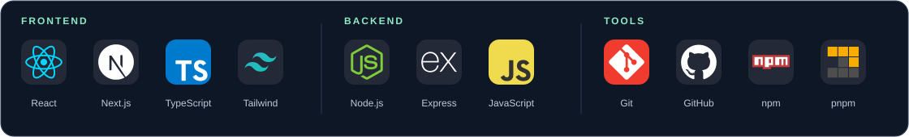

  

## A little about me

Hey, I'm **Asif** 👋 — a full-stack developer from **Kannur, Kerala, India**. I work across the browser and backend, building web applications, APIs, and integrations between systems.

> Most of my professional work lives in private company repositories. This space is a snapshot of my skills and the kind of development I do.

## From interface to integration

- **Web experiences** — React and Next.js interfaces, styling, and application flows.
- **Backend connections** — APIs and integrations that connect applications and services.
- **Everyday automation** — scheduled jobs and data-sync workflows.

## My toolkit

  

  

